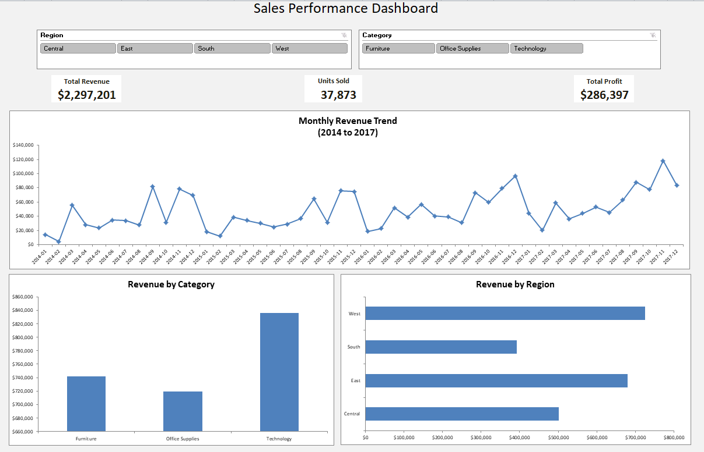

# Task 1: Sales Performance Dashboard (Excel)

## Objective
Build an Excel dashboard summarizing sales performance of a retail superstore.

## Dataset
Superstore Dataset (Kaggle, vivek468). 9,994 orders, 2014 to 2017.

## What I did
1. Imported the CSV and set correct data types (dates, text IDs).
2. Cleaned the data: checked duplicates (0 found), converted to an Excel Table.
3. Added helper columns: Year, Month, Year-Month, Shipping Days, Profit Margin.
4. Built pivot tables: total revenue, units sold, profit, revenue by category, region, and monthly trend.
5. Created charts and a Dashboard sheet with KPI cards.
6. Added Region and Category slicers, and MoM and YoY change.

## Key results
- Total revenue: $2,297,201
- Units sold: 37,873
- Total profit: $286,397
- Best region: West ($725,458
- Best category: Technology ($836,154)
- YoY change: 2015 [-2.8%], 2016 [+29.5%], 2017 [+20.4%]
- Sales peak in: Q4 (September, November, and December)

## Dashboard

## Files
- `Sales_Dashboard.xlsx`: the full workbook
- `data/`: raw dataset
- `dashboard.png`: screenshot

## Tools
Excel: Tables, formulas, PivotTables, PivotCharts, Slicers