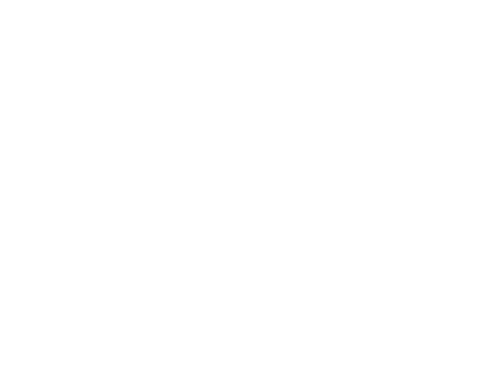
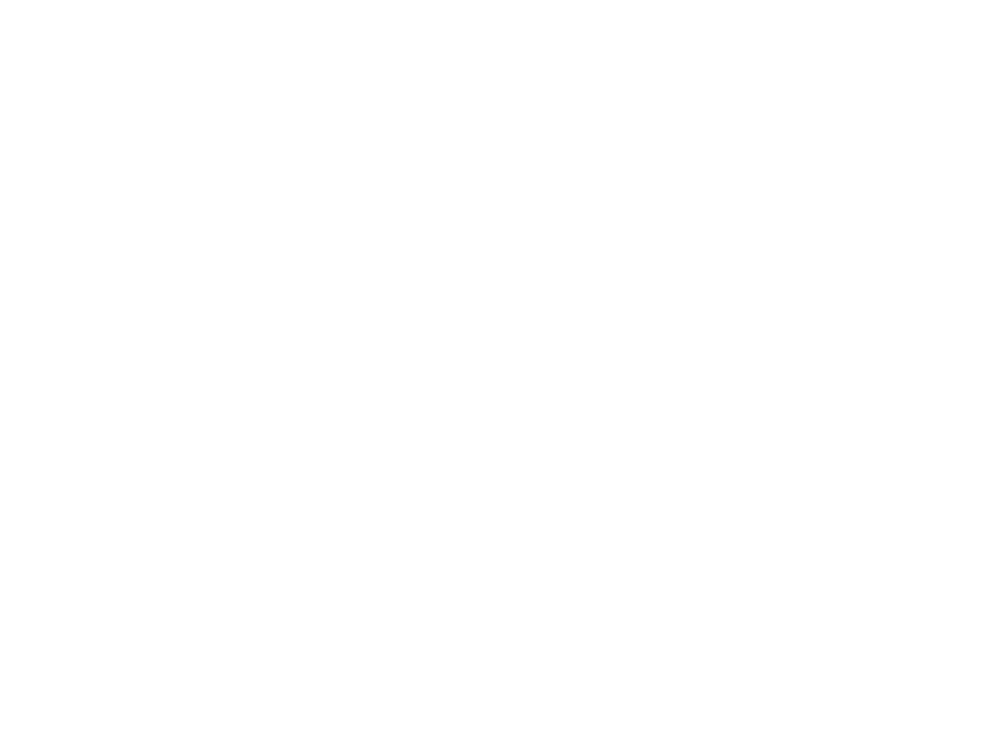

# Task 2: Exploratory Data Analysis on the Titanic Dataset

## Objective
Explore the Titanic passenger data with Python to find which factors were linked to survival.

## Dataset
Titanic: Machine Learning from Disaster (Kaggle), `train.csv`. 891 passengers, 12 columns.

## What I did
1. Loaded and inspected the data (shape, types, missing values).
2. Cleaned it: filled Age with the median, Embarked with the mode, flagged Cabin (HasCabin) and dropped it, converted Sex and Embarked to category, checked duplicates (0).
3. Calculated summary statistics and group-based survival rates (gender, class, age group).
4. Visualized patterns: bar plots, histogram, boxplot, correlation heatmap.
5. Bonus: survival-rate bar plots and heatmaps.

## Key insights
- Overall survival rate: 38.4%
- Women survived far more than men in every class (1st-class women 97%, men 37%).
- Class mattered: 3rd-class women survived at only 50%, 3rd-class men at 14%.
- Children had the best survival among age groups (58%).
- Survival correlates with Pclass (-0.34), HasCabin (+0.32), Fare (+0.26). These overlap, since all relate to wealth.
- Gender and Survived correlation: 0.54

## Visuals

## Files
- `titanic_eda.ipynb`: full analysis notebook
- `data/train.csv`: raw dataset
- `images/`: saved charts

## Tools
Python, Pandas, Seaborn, Matplotlib, VS Code (Jupyter)