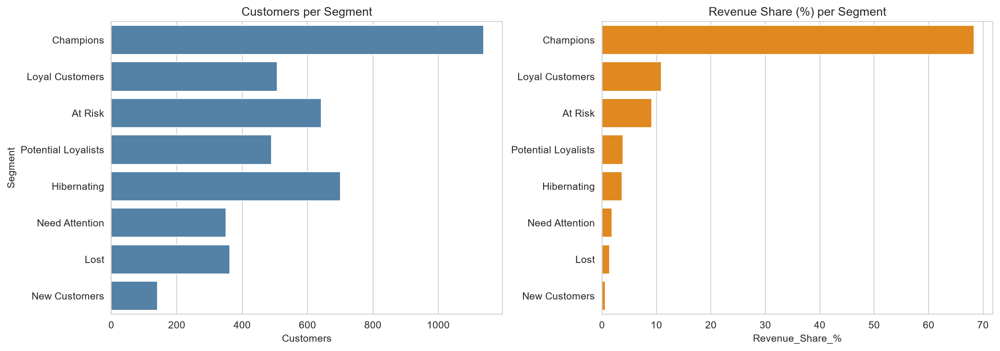
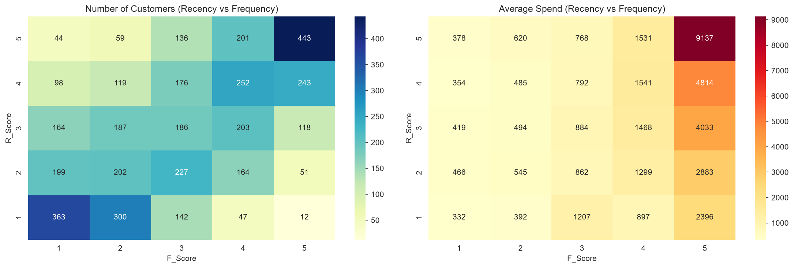

# Task 3: Customer Segmentation Using RFM Analysis

## Objective
Group customers by purchase behavior (Recency, Frequency, Monetary) and suggest a marketing action for each group.

## Dataset
Online Retail (UCI). UK online shop transactions, Dec 2010 to Dec 2011. 541,909 rows.

## What I did
1. **Cleaned the data:** dropped rows with no CustomerID, removed cancellations (invoices starting with "C"), removed non-positive quantity or price, and removed duplicates. 541,909 rows became 392,692.
2. **Feature engineering:** built one row per customer:
   - Recency = days since last purchase (snapshot date = day after the last invoice)
   - Frequency = number of distinct invoices
   - Monetary = total spend (Quantity x UnitPrice)
3. **Scored** each metric from 1 to 5 using quintiles (5 = best, Recency reversed).
4. **Segmented** customers into 8 groups using rules on R and F scores.
5. **Visualized** segment size, revenue share, and RFM heatmaps.

## Data decisions
- Removed 2 customers (12346, 16446) whose huge orders were cancelled minutes later, which falsely inflated their spending.
- Frequency has many ties (many customers bought once), so I broke ties by rank before scoring.
- Segment rules are a judgment call and can be adjusted.

## Key results
- 4,336 customers analysed.
- Champions: 26% of customers, **68% of revenue**.
- Champions + Loyal Customers: 38% of customers, 79% of revenue.
- At Risk: 15% of customers, 9% of revenue. They spent about 1,241 on average, so they are the top win-back target.
- Lost + Hibernating: 25% of customers but only 5% of revenue.

## Marketing ideas
| Segment | Idea |
|---|---|
| Champions | Reward and retain: early access, loyalty tier. No deep discounts. |
| Loyal Customers | Upsell, bundles, loyalty program. |
| Potential Loyalists | Nudge a third order with a small coupon and recommendations. |
| New Customers | Welcome emails, small discount on the second order. |
| Need Attention | Time-limited offers and reminders. |
| At Risk | Highest-priority win-back: personal message and stronger discount. |
| Hibernating | Low-cost automated re-engagement email. |
| Lost | One last offer or survey, then stop. |

## Visuals

## Files
- `rfm_analysis.ipynb`: full analysis
- `rfm_segments.csv`: each customer with R, F, M, scores and segment
- `data/`: raw dataset
- `images/`: saved charts

## Limitations
One retailer and one year of data. Segments describe this shop, not all shops.

## Tools
Python, Pandas, NumPy, Seaborn, Matplotlib, VS Code (Jupyter)