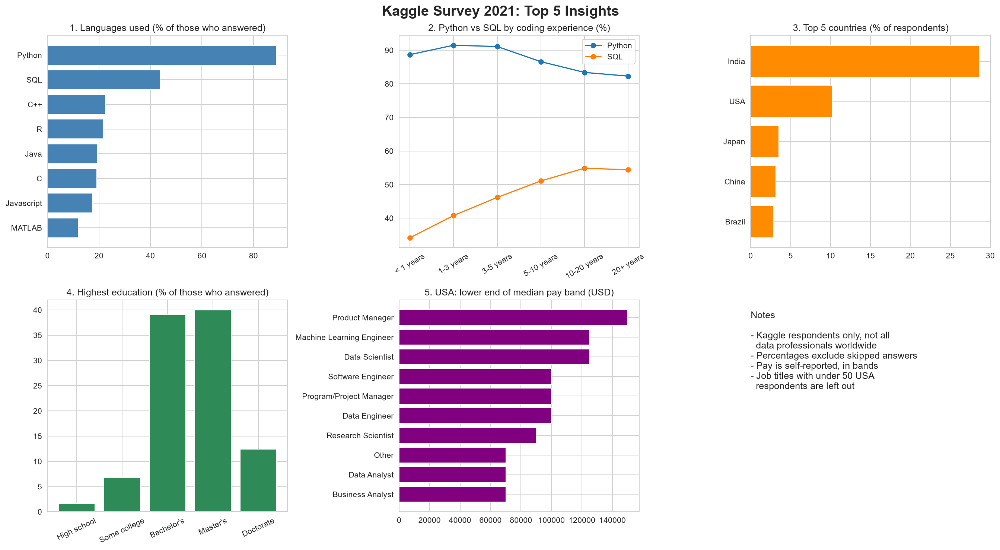

# Task 4: Cleaning and Analyzing Survey Data

## What this project is about
Every year, Kaggle asks thousands of people who work with data about their jobs, tools, and education. In this project I took the 2021 answers (25,973 people) and did two things:
1. **Cleaned** the messy answers so they could be counted correctly.
2. **Found insights** about what these people do and prefer.

## The problems in the data, and how I fixed them
| Problem | Example | What I did |
|---|---|---|
| A question row mixed in with the people | Row 2 held question text, not a person | Separated it from the data |
| Inconsistent text | Curly vs straight apostrophes, extra spaces | Made all answers consistent |
| "Prefer not to answer" | Not a real answer | Treated as missing |
| Many empty cells | Students were never shown the job questions | Kept them, since empty here means "not asked", not "bad data" |
| Duplicates | Identical rows | Checked: none found |

## Turning answers into numbers
Computers work better with numbers than words, so I converted answers in three ways:
- **Ordered mapping:** for answers with a natural order. Example: High school = 1, Bachelor's = 3, Master's = 4.
- **Label encoding:** for answers with no order. Each country or job gets an ID number, like a jersey number. The ID is just a name tag, not an amount.
- **Yes/No columns (0 or 1):** for "select all that apply" questions. Example: a person who uses Python and SQL gets 1 in the Python column, 1 in the SQL column, and 0 for every other language.

## Top 5 insights
1. **Python and SQL are the most used languages:** Python 88.8%, SQL 43.7%, R 21.7%.
2. **More experience means more tools:** SQL use grows from 34.2% (under 1 year of coding) to 54.4% (20+ years).
3. **Most respondents come from India (28.6%) and the USA (10.2%).** 80.4% are men.
4. **The group is highly educated:** 52.4% have a Master's degree or higher.
5. **Pay depends on country and job:** the typical USA pay band is 100,000-124,999 USD, versus 5,000-7,499 in India (not adjusted for cost of living). In the USA, Data Scientists typically earn more than Data Analysts.

## Dashboard

## What is in this folder
| Name | What it is |
|---|---|
| `survey_analysis.ipynb` | The full analysis, step by step, with code and charts |
| `survey_cleaned_selected_columns.csv` | The cleaned data (key columns only) |
| `data/` | The original, untouched Kaggle file |
| `images/` | The dashboard picture shown above |

## Things to keep in mind
- Kaggle respondents are not a random sample of everyone who works with data.
- Pay is self-reported and given in ranges, so I report the typical range, not exact salaries.
- These results describe 2021 only.

## Tools
Python, Pandas, NumPy, Seaborn, Matplotlib