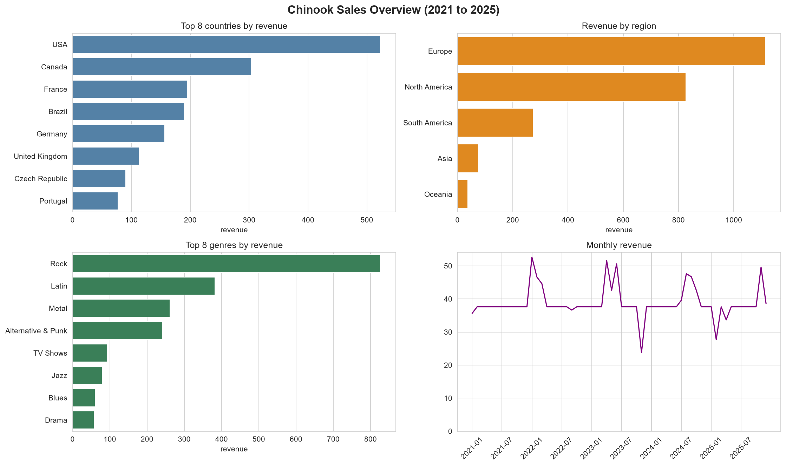

# Task 5: SQL-Based Analysis of Product Sales

## What this project is about
Chinook is a sample database of a digital music store. In this project I used SQL to answer business questions: what sells best, where the money comes from, and how sales change month by month. I also used Python to run the queries and draw charts.

## The data
- Database: Chinook (PostgreSQL version), 11 tables
- Main tables used: `track` (the products), `invoice` (orders), `invoice_line` (items on each order), `customer`, `genre`
- Period: January 2021 to December 2025
- Size: 412 orders, 2,240 items sold, 59 customers, 24 countries

## How the tables connect
`customer` -> `invoice` (one order) -> `invoice_line` (items on the order) -> `track` (the product) -> `genre`

A JOIN uses the matching ID numbers to connect one table to the next.

## Business questions and answers
| Question | Answer |
|---|---|
| Total revenue? | 2,328.60 (2,240 units, 412 orders) |
| Top-selling products? | Eight tracks tie for first with 2 units each. Every other track sold 1. Because of this large tie, a "top 10" list is partly arbitrary. |
| Best genre? | Rock: 826.65, about 35.5% of revenue. The top 4 genres (Rock, Latin, Metal, Alternative & Punk) bring 73.5%. |
| Revenue per country? | USA 523.06 (22.5%), Canada 13.1%, France 8.4%, Brazil 8.2%, Germany 6.7% |
| Revenue per region? | Europe 47.9%, North America 35.5%, South America 11.8%, Asia 3.2%, Oceania 1.6% |
| Monthly performance? | Very stable: about 7 orders per month (54 of 60 months have exactly 7) and about 37.62 revenue in a typical month. No clear growth or seasonality. |
| Yearly revenue? | 2021: 449.46, 2022: 481.45, 2023: 469.58, 2024: 477.53, 2025: 450.58 |

## Things I found worth noting
- **Countries differ mainly in number of customers.** The USA has 13 customers and 15 countries have only 1, but revenue per customer is similar everywhere (about 37 to 47).
- **Units and revenue rank genres differently.** TV Shows sold only 47 units but earned 93.53, more than Jazz (80 units, 79.20), because video tracks cost 1.99 and songs cost 0.99.
- **Month-to-month changes are mostly noise.** The spikes most likely come from a few higher-priced items, and the dips from months with fewer orders.
- **Every item sold has quantity 1**, so "units sold" equals the number of order lines.
- **Genre labels overlap** (for example "Metal" and "Heavy Metal"). I kept them as they are in the data.
- **The database has no region column**, so I created regions from countries with a CASE statement.

## Window functions (bonus)
- `ROW_NUMBER`, `RANK` and `DENSE_RANK` compared on tied top tracks: ROW_NUMBER counts 1, 2, 3 even for ties, RANK gives ties the same rank and then skips, and DENSE_RANK gives ties the same rank without skipping.
- `ROW_NUMBER` with `PARTITION BY genre` to get the top 3 tracks inside each genre.
- `LAG` to calculate month-over-month change, and `SUM() OVER` for a running total (it ends at 2,328.60, matching the total).

## Checks I did
- Revenue from the `invoice` table and from `invoice_line` both give 2,328.60.
- Orders, units and customers add up across all countries and regions after the JOINs.
- Customer country and billing country never disagree.

## Data loading note
The Chinook script failed to load on Windows because the connection reset to the WIN1252 text encoding after the script reconnected, which broke the album, track and invoice_line inserts. I fixed it by adding `SET client_encoding = 'UTF8';` right after the script's connect line. All table counts matched afterwards.

## Dashboard

## Files
| Name | What it is |
|---|---|
| `queries/` | All SQL queries, one file per step |
| `sales_analysis.ipynb` | Python notebook that runs queries and draws the charts |
| `data/Chinook_PostgreSql.sql` | The database script (with the one-line encoding fix) |
| `images/` | The dashboard picture |

## How to run it yourself
1. Install PostgreSQL and run the script in `data/` with psql.
2. Run the files in `queries/` in pgAdmin, in order.
3. Open the notebook, enter your database password when asked, and run all cells.

## Limitations
Chinook is a small sample dataset. Orders are very regular, so the results show how to analyze sales rather than real market behavior.

## Tools
PostgreSQL, SQL (JOINs, GROUP BY, CASE, CTEs, window functions), Python, Pandas, SQLAlchemy, Seaborn, Matplotlib