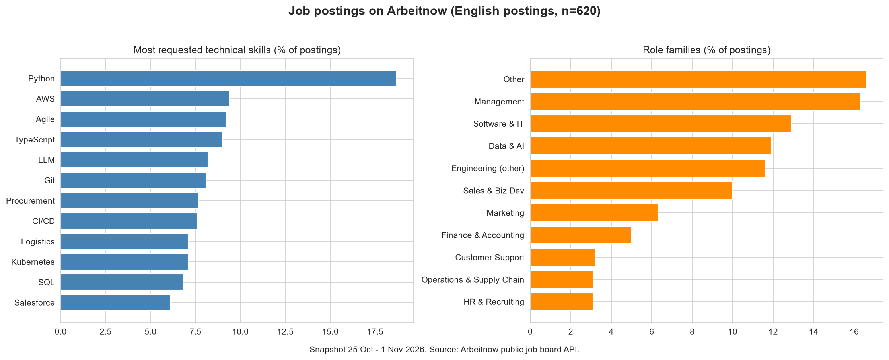
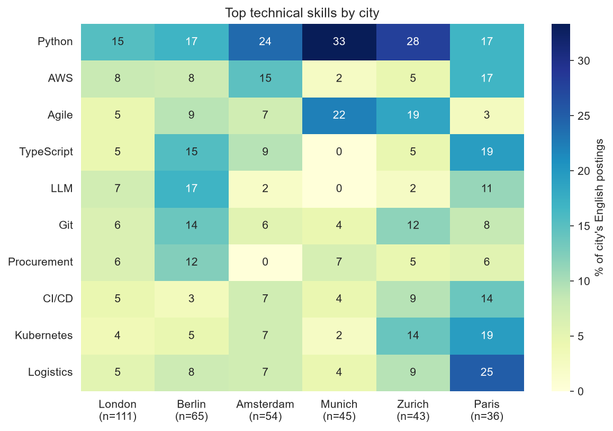

# Task 6: Web Scraping and Analysis of Job Postings

## What this project is about
I collected job postings from a job board, cleaned the text, and counted which skills and roles appear most. The goal is to learn how to collect data responsibly and how to turn messy text into numbers.

## Choosing a source: why not Indeed
The task suggests Indeed as an example. I checked first:
- Indeed's robots.txt contains a long list of `Disallow` rules, and its terms of service prohibit automated collection of listings. I did not scrape it.
- **Arbeitnow** (a European and remote job board) offers a free public API for developers. Its robots.txt has no restriction on the API (it blocks only one tracking-parameter pattern), and the API response states its terms.
- To also show HTML scraping, I scraped the static practice site "Fake Jobs" from Real Python (its robots.txt returns 404, so no restrictions; the site exists for practice) using requests and BeautifulSoup. It gave 100 postings, all dated the same day, so it is a technique demo, not part of the analysis.

## Data
- 1,441 postings collected (25 Oct to 1 Nov 2026), 1,426 after removing repeated postings.
- Fields: title, company, location, posted date, description, remote flag, link.
- Data credit: job listings from [Arbeitnow](https://www.arbeitnow.com), via their public API.
- The full descriptions are not stored in this repository, to respect the source. Run the notebook to collect fresh data.

## What I did
1. Checked robots.txt and the terms before collecting.
2. Collected 5 pages from the API and saved the raw snapshot.
3. Scraped a static HTML page with BeautifulSoup (title, company, location, date).
4. Cleaned the data: removed repeated postings, turned messy locations into cities (merged `Zurich`/`Zürich`, `Berlin Office`/`Berlin`, removed `Homeoffice` and country-only values), converted timestamps to dates, stripped HTML from descriptions, and removed email addresses and links.
5. Kept only English-language postings for skill counting (620 of 1,426), because my skill list is in English.
6. Built a dictionary of 50+ skills and counted the share of postings that mention each one (one posting counts once).
7. Spot-checked risky matches by reading the surrounding text.
8. Compared skills across cities with a heatmap (bonus).

## Results
- **Most requested technical skills** (share of English postings): Python 18.7%, AWS 9.4%, Agile 9.2%, TypeScript 9.0%, LLM 8.2%, Git 8.1%, CI/CD 7.6%, Kubernetes 7.1%, SQL 6.8%.
- **Soft skills:** Collaboration appears in 58.2% of postings, Communication 47.9%, Leadership 30.8%. These words appear in nearly every description, so they say little about what sets jobs apart.
- 61.8% of English postings mention at least one technical skill.
- **Roles** (all 1,426 postings, by title): Software and IT 16.1%, Management 13.4%, Data and AI 13.2%; 23.7% could not be classified (many titles are in French or German).
- **By city** (English postings, cities with at least 30):

| City | Postings | Top skills |
|---|---|---|
| London | 111 | Python 15%, Salesforce 10%, AWS 8%, LLM 7%, Git 6% |
| Berlin | 65 | Python 17%, LLM 17%, TypeScript 15%, Git 14%, Procurement 12% |
| Amsterdam | 54 | Python 24%, AWS 15%, Salesforce 11%, Azure 11%, TypeScript 9% |
| Munich | 45 | Python 33%, Agile 22%, Machine Learning 16%, C++ 13%, Project Management 13% |
| Zurich | 43 | Python 28%, Agile 19%, Jira 16%, Kubernetes 14%, C++ 14% |
| Paris | 36 | Logistics 25%, Kubernetes 19%, TypeScript 19%, Python 17%, AWS 17% |

## Charts (Bonus task)

## Limitations
- It is a one-week snapshot of one job board, so it shows what this board advertised that week, not the whole job market and not trends over time.
- The board leans toward tech and European employers.
- Only English postings were analysed (43.5%). Paris keeps just 36 English postings, so its column describes English-speaking employers there.
- City samples are small (36 to 111 postings), so differences between cities are hints, not proof. One employer posting many similar jobs can inflate a skill.
- Skills are keyword matches. I spot-checked a sample (React, Salesforce and Snowflake matches were all real tool requirements), but misses and false matches are possible, and skills not in my list are not counted.

## Files
| Name | What it is |
|---|---|
| `job_scraping.ipynb` | The full notebook: rules check, collection, scraping, cleaning, analysis, charts |
| `data/fake_jobs_scraped.csv` | Output of the HTML scraper on the practice site |
| `data/jobs_skill_flags.csv` | Postings with title, company, city, role and 0/1 skill flags (no description text) |
| `data/skill_frequency.csv` | Share of postings mentioning each skill |
| `data/skills_by_city.csv` | The heatmap numbers |
| `images/` | The charts |

## How to run it yourself
1. `pip install requests beautifulsoup4 pandas seaborn matplotlib`
2. Run the notebook from the top. It collects fresh data from the API (5 pages, with pauses).

## Tools
Python, requests, BeautifulSoup, pandas, regular expressions, seaborn, matplotlib
