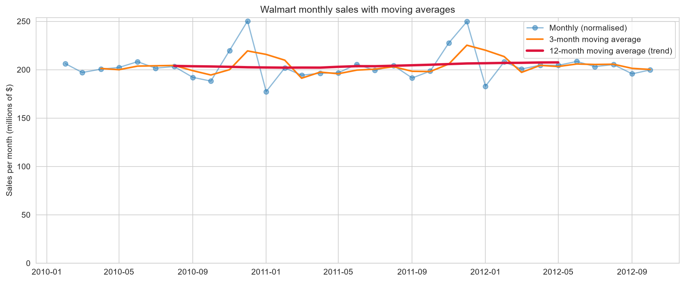
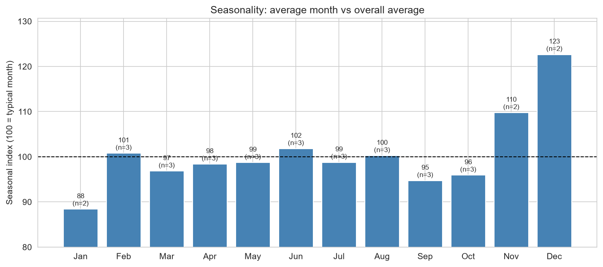
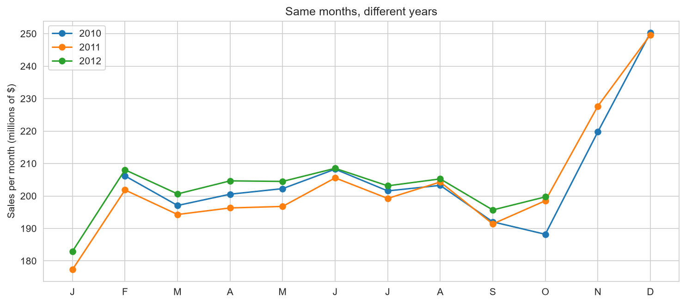
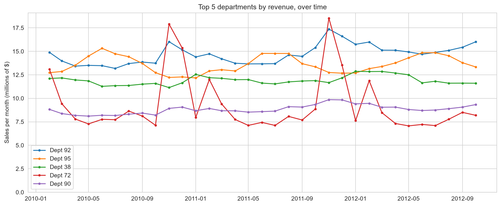
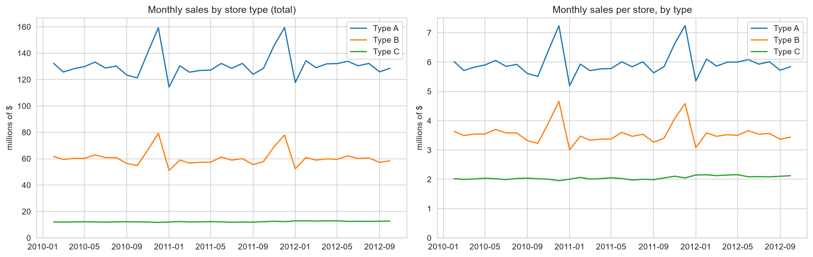
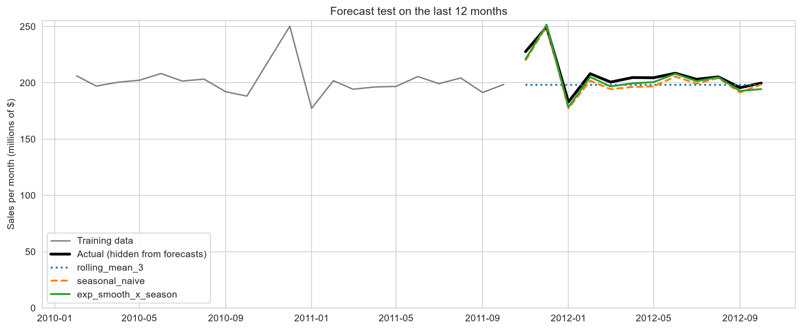

# Task 7: Time Series Breakdown of Retail Sales

## What this project is about
I analysed three years of weekly sales from 45 Walmart stores to answer: is the business growing, when are the busy seasons, which departments and store types earn the most, and can a simple method forecast the next months? The data covers 5 Feb 2010 to 26 Oct 2012.

## Data
- Kaggle competition "Walmart Recruiting - Store Sales Forecasting": `train.csv` (421,570 rows: one department in one store in one week), `stores.csv` (45 stores: type A/B/C and size), `features.csv` (weather and economy).
- The raw files are **not included** in this repository, because competition data is not for redistribution. Download them from Kaggle and place them in `data/`.
- Included: my own summary tables (weekly and monthly totals, forecast results).

## What the data does and does not contain
- **Weekly, not monthly.** I added the weeks up into months.
- **"Product" = department.** Departments are anonymous numbers, so I do not name them.
- **No region column.** I used store and store type (A/B/C). Types are not geographic regions.
- 143 weeks, all Fridays; all 45 stores report every week; 0 duplicates.
- 1,285 negative rows (returns) sum to about -0.001% of total sales, so I kept them as real net sales.

## The monthly trap (and how I handled it)
A month has 4 or 5 Fridays, so a 5-week month looks bigger just because it has an extra week. In this data, 5-week months total about 29% more than 4-week months, but average weekly sales differ by only 3.4%. I used a normalised monthly figure: average weekly sales x 52 / 12.

## What I did
1. Loaded and merged the three files, checking that row counts stayed the same after each merge.
2. Built the weekly and normalised monthly series (33 months).
3. Trend: 3-month and 12-month moving averages, and year-over-year change.
4. Seasonality: a seasonal index per calendar month, a cross-check against the trend, and a look at holiday weeks.
5. Breakdown by department and by store type over time.
6. Bonus: five simple forecasts, tested on the last 12 months that I hid from them.

## Key findings
- **No strong trend.** Average level for February to October: 199.9M (2010), 198.7M (2011, -0.6%), 203.4M (2012, +2.3%). Average year-over-year change +1.1%.
- **Clear seasonality.** Seasonal index (100 = typical month): December 122.6, November 109.8, January 88.4 (weakest), September 94.7, October 95.9; February to August stay between about 97 and 102. November, December and January rest on only two years each.
- **The holiday flag is incomplete.** Thanksgiving weeks are flagged and strong (+33% vs neighbouring weeks). The two biggest weeks of all (24 Dec 2010: 80.9M and 23 Dec 2011: 77.0M) and the next four are pre-Christmas weeks that are **not** flagged. The flagged Christmas week is the week ending 31 Dec, which is weak (it appears to be the post-Christmas week). A model using this flag would miss the biggest peak.
- **Revenue is concentrated.** 29 of 81 departments make 80% of sales. The top three (Depts 92, 95, 38) make 7.2%, 6.7% and 5.8%.
- **Departments have different seasons.** Dept 72 is a holiday department (index 189 in November, 150 in December); Dept 95 peaks in June to August (108 to 111) and dips in November to January (92); Depts 38 and 90 are nearly flat.
- **Growth by department** (February to October 2012 vs 2011): from -2.1% (Dept 72) to +7.1% (Dept 92) among the top 15; all departments together +2.5%.
- **Store types:** A earns 64.3% of revenue, B 29.7%, C 6.0%, and these shares barely changed over the period. Average monthly sales per store: A 5.96M, B 3.56M, C 2.05M. Types differ in size, so this is not a measure of efficiency.
- **Top 5 stores** (20, 4, 14, 13, 2) bring 21.5% of revenue; all are Type A.

## Forecasting (bonus)
Hid the last 12 months (Nov 2011 to Oct 2012), forecast them from the first 21, and compared. Seasonal indices and levels used only the training months, and the smoothing weight (0.3) was fixed in advance.

| Method | Average error (MAPE) |
|---|---|
| Level x seasonal index | 1.5% |
| Exponential smoothing x seasonal index | 1.6% |
| Same month last year | 2.3% |
| Last month repeated | 5.5% |
| 3-month rolling mean | 5.6% |

Methods that include seasonality are 3 to 4 times more accurate than flat ones. The top two are effectively tied. A "nothing changes" projection for Nov 2012 to Jan 2013 is 226.8M, 253.4M, 182.7M per normalised month, close to the same months a year earlier.

## Charts

## Limitations
- Only 33 months: February to October appear three times, but November, December and January only twice, so seasonal percentages are rough.
- Each week is assigned to the month of its Friday date.
- The forecast test covers only 12 months. The projection ignores promotions, prices and the economy.
- Department numbers are anonymous; "region" is approximated by store type.

## Files
| Name | What it is |
|---|---|
| `retail_time_series.ipynb` | The full analysis |
| `data/weekly_total_sales.csv`, `data/monthly_sales.csv` | Weekly and monthly totals I built |
| `data/forecast_backtest.csv`, `data/forecast_scores.csv` | Forecast test results |
| `images/` | The charts |

## Tools
Python, pandas, numpy, matplotlib, seaborn