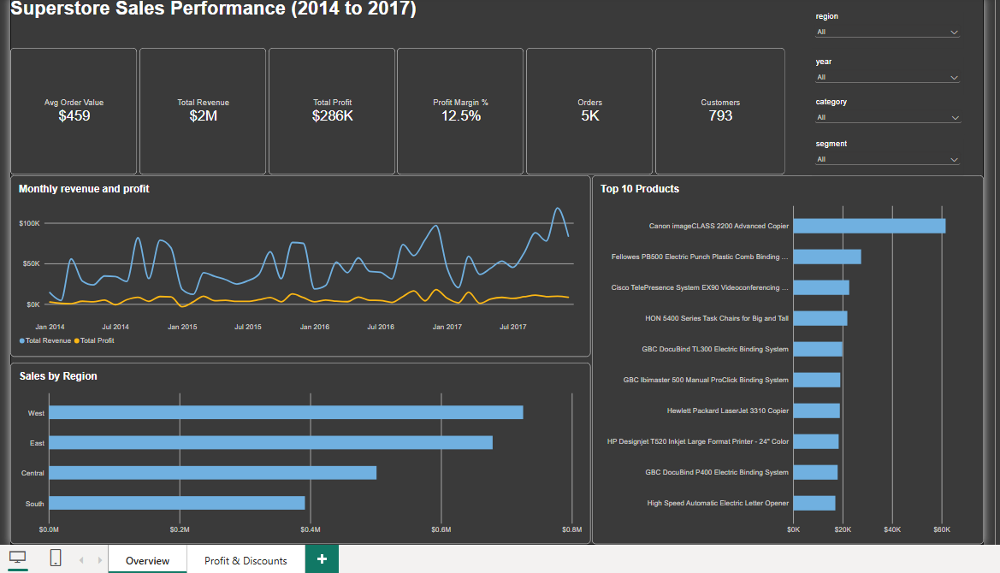
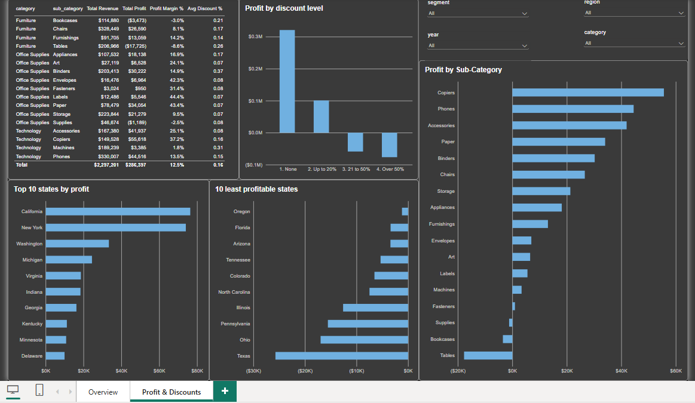
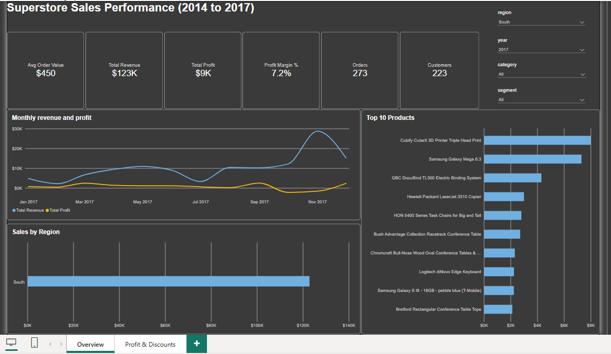

# Task 8: Power BI Dashboard for Retail Insights

## The question
Where does Superstore make money, and where does it lose it? The dashboard answers this for 4 years of orders (3 Jan 2014 to 30 Dec 2017).

## Data
Superstore Sales Dataset (Kaggle): 9,994 order lines, 21 columns. The raw file is the same one used in Task 1 and is not copied here.

## Data preparation (Python)
- Dates converted from text to real dates; postal codes kept as text (449 had lost a leading zero and were restored to 5 digits).
- Checks: 0 missing cells, 0 duplicate rows, unique Row ID, shipping time 0 to 7 days.
- 8 order lines repeat the same Order ID and Product ID; they are real separate lines (totals match), so they were kept.
- 32 product IDs carry more than one name, so the product dimension has more rows than unique IDs. Product rankings group by product name.
- Built a star schema and verified that totals are unchanged after every merge: sales 2,297,200.86, profit 286,397.02, units 37,873.

## Data model
One fact table (`fact_sales`, one row per order line) and four dimensions: product, customer, location and a complete date table (1,461 days, marked as the date table). Relationships are many-to-one with single-direction filters from each dimension to the fact table.

## Measures (DAX)
Total Revenue, Total Profit, Units Sold, Orders, Customers, Profit Margin % (total profit divided by total revenue, never an average of row ratios), Average Order Value, Average Discount %, loss-making lines, revenue last year and year-over-year %, month-over-month %, and revenue share %.

## Dashboard
- **Page 1, Overview:** KPI cards, monthly revenue and profit, sales by region, top 10 products. Slicers: year, region, category, segment, with a reset button.
- **Page 2, Profit and Discounts:** profit by discount band, profit by sub-category, top 10 and bottom 10 states by profit, and a category matrix with conditional formatting.
- A hidden tooltip page shows margin and profit trend when hovering over a region.
- Custom visual: Chiclet Slicer.

## Key findings
- Revenue 2,297,201; profit 286,397; overall margin 12.5%; 793 customers; 5,400 orders.
- Revenue by year: 2014 ($484K) , 2015 ($471K), 2016 ($609K), 2017 ($733K).
- Top products by revenue: Canon imageCLASS 2200 Advanced Copier, a Fellowes electric binding machine, and the Cisco TelePresence EX90 video-conferencing unit.
- Best region by revenue: West; lowest margin region: south.
- Loss-making sub-categories: Tables.
- **Discounts are strongly associated with losses:**

| Discount | Order lines | Sales | Profit | Margin |
|---|---|---|---|---|
| none | 4,798 | 1,087,908 | 320,988 | 30% |
| up to 20% | 3,803 | 846,522 | 100,785 | 12% |
| 21 to 50% | 537 | 298,541 | -58,817 | -20% |
| over 50% | 856 | 64,229 | -76,559 | -119% |

  Lines discounted above 20% are about 14% of all lines and 16% of sales, yet their combined profit is -135,376. This is an association: discounts may have been given to products that were already unprofitable, so the data cannot prove they caused the losses.

## Publishing
The report was published to the Power BI service (My workspace) and tested there. "Publish to web" was **not available**: the account's admin has not enabled public embed codes, so there is no public link. The `.pbix` file is included, and the screenshots and PDF show the dashboard.
The map visual is also disabled by the organization's admin in the online service, so I used top 10 and bottom 10 state bar charts instead.

## Limitations
- One sample retailer; the data is US-only and ends in 2017.
- Profit margin for a group is total profit divided by total revenue.
- 2014 has no year-over-year value because there is no 2013 in the data.

## Files
| Name | What it is |
|---|---|
| `superstore_dashboard.pbix` | The Power BI report (open with Power BI Desktop, free) |
| `superstore_prep.ipynb` | Python cleaning and model building |
| `data/model/` | The five model tables exported from Python |
| `images/` | Screenshots and PDF of the dashboard |

## Tools
Python (pandas), Power BI Desktop (Power Query, data model, DAX), Power BI service